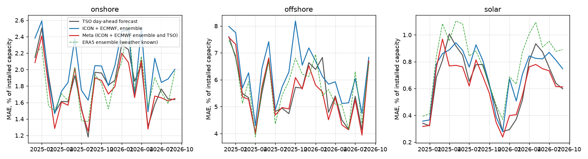
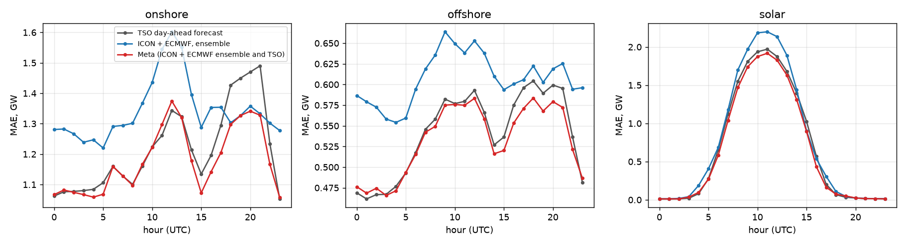
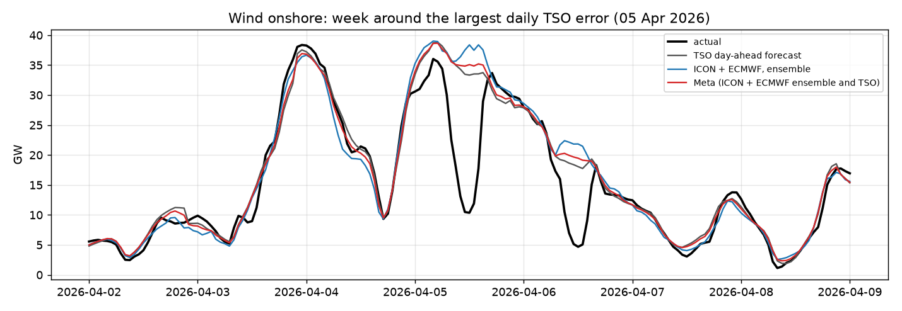
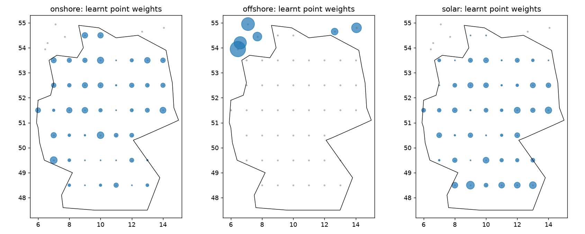
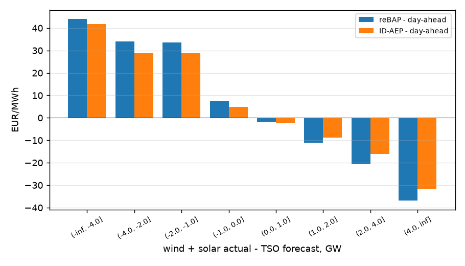
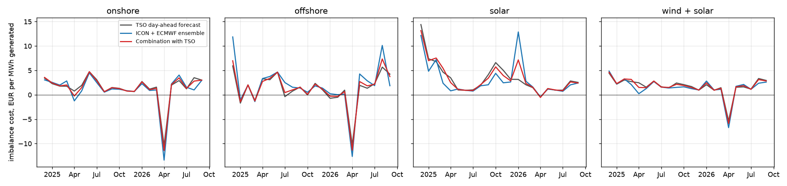

# From weather forecasts to power: day-ahead wind and solar generation in Germany (v0.2)

[](https://github.com/michaelserikov/de-weather-to-power/actions/workflows/tests.yml)

How well can German wind and solar generation for tomorrow be forecast from public weather forecasts, and does such a forecast add anything to the forecast the transmission system operators (TSOs) publish? This project turns day-ahead numerical weather predictions (DWD ICON and ECMWF IFS, issued about 24 hours before the valid hour) at 52 points into hourly forecasts of onshore wind, offshore wind and solar generation, evaluates them out of sample over 22 months (December 2024 to September 2026, 16,054 hours) and compares and combines them with the TSO day-ahead forecast. Version 0.2 prices the forecast errors at the German imbalance price (reBAP): what each forecast would cost a wind or solar portfolio that sells its forecast day-ahead and settles the difference as imbalance.

**Main findings**
- A public-data model does not beat the TSOs on its own, but it carries independent information. Combining it with the TSO forecast (a linear combination re-estimated every month on past forecasts only) lowers the TSO's mean absolute error by 2.9% for onshore wind (Diebold-Mariano p = 0.001), 5.2% for solar (p = 0.005) and 1.5% for offshore wind (p = 0.09). The error of total wind and solar generation, which is what moves residual load and prices, falls from 1.76 to 1.68 GW.
- Two weather models are better than one. Adding ECMWF to ICON cuts the error of the stand-alone forecast by 15% for onshore wind, 10% for offshore wind and 8% for solar.
- The weather forecast is not where most of the error comes from. The same models fed with ERA5 reanalysis, i.e. with the weather that actually happened, still miss onshore wind by 1.22 GW, against 1.34 GW with the day-ahead forecasts. Most of the remaining error lies in translating coarse point weather into fleet output (where the turbines are, hub heights, outages, curtailment), so that is where the next gains are.
- The largest error of the period is not a weather error. On Easter Sunday, 5 April 2026, the day-ahead price fell to -105 EUR/MWh and onshore wind output dropped from about 34 GW to 10 GW around noon while every forecast stayed above 33 GW: plants were switched off at negative prices. Across all 1,041 negative-price hours, forecasts overestimate onshore wind by 1.5 GW (TSO) to 2.0 GW (this model). Giving the models the expected solar output and the day type (working day, Saturday, Sunday or holiday) lets them anticipate part of it: the onshore error in negative-price hours falls by 11% and the overall onshore error by 5%.
- Accuracy is not the same as value. At German imbalance prices, the stand-alone ICON + ECMWF forecast, although 9% less accurate than the TSO forecast for wind and solar together, costs 1.46 instead of 1.74 EUR per MWh generated (saving 0.27 EUR/MWh, HAC t = 2.0): its errors move less with the system imbalance, so it is less often short when reBAP is high and long when it is low. For onshore wind the saving corresponds to about 0.6 million EUR per GW and year. Offshore wind shows the opposite sign (not significant). See [v0.2: what the errors cost](#v02-what-the-forecast-errors-cost-at-imbalance-prices).
- Fed-in solar power per unit of irradiance and installed capacity fell by about 10% between summer 2024 and summer 2025, so a model trained on last year overestimates this year (bias +390 MW). This is consistent with rising self-consumption and with the rules for new systems in force since 25 February 2025 (no feed-in payment in negative-price hours, feed-in limited to 60% of rated power without a smart meter). A rolling correction of the forecast level over the last 30 days, with a two-day publication lag, removes the bias and lowers the solar error by 12%.

## Results

Mean absolute error in MW and in % of installed capacity (nMAE), 1 Dec 2024 to 30 Sep 2026, all forecasts out of sample. Skill is the reduction of MAE relative to the TSO forecast.

| | Onshore wind MAE | nMAE | skill | Offshore wind MAE | nMAE | skill | Solar MAE | nMAE | skill |
|---|---|---|---|---|---|---|---|---|---|
| TSO day-ahead forecast | 1,215 | 1.81% | | 541 | 5.56% | | 682 | 0.65% | |
| ICON, ensemble | 1,572 | 2.35% | -29% | 678 | 6.96% | -25% | 812 | 0.77% | -19% |
| ICON + ECMWF, ensemble | 1,342 | 2.00% | -10% | 607 | 6.24% | -12% | 751 | 0.71% | -10% |
| **Combination of ICON + ECMWF and TSO** | **1,179** | **1.76%** | **+2.9%** | **533** | **5.48%** | **+1.5%** | **646** | **0.62%** | **+5.2%** |
| ERA5 ensemble (weather known) | 1,221 | 1.82% | -0.6% | 560 | 5.74% | -3.3% | 851 | 0.81% | -25% |

Mean installed capacity over the sample: onshore 67.1 GW, offshore 9.8 GW, solar 105.0 GW. Full tables, including the single models and Diebold-Mariano tests: [results/tables/results.md](results/tables/results.md).

For solar, the ERA5 run is worse than the day-ahead forecasts: ERA5 (about 31 km) resolves clouds less well than ICON (down to 2 km over Germany), so reanalysis is a good stand-in for "known weather" for wind but not for solar irradiance.





The stand-alone model is weakest for onshore and offshore wind around midday, when curtailment at negative prices is most frequent, and for solar at the noon peak. In the evening (18:00-21:00 UTC), when onshore wind ramps matter most for the evening price peak, it is more accurate than the TSO forecast (1.33 vs 1.47 GW at 21:00 UTC), and this is where the combination gains most.



The models learn where the capacity is. The point weights of the non-negative linear model put most offshore weight on the North Sea clusters, and most solar weight in the south, without being told where any plant stands:



## v0.2: what the forecast errors cost at imbalance prices

A portfolio with the generation profile of the German fleet sells its day-ahead forecast in the auction and settles the difference between actual output and forecast at reBAP, the uniform German imbalance price. Against a perfect forecast the error costs

    cost = (day-ahead price - reBAP) x (actual - forecast)

per hour (reBAP for short and long positions was identical in every hour of the sample). The portfolio is a price-taker: its errors move with the system imbalance, but it is too small to move reBAP. There is no intraday trading in this setup; the whole error goes to imbalance settlement. Quarter-hourly reBAP and ID-AEP are averaged to hours. Sample: December 2024 to September 2026, 16,054 hours.

**Imbalance prices follow the national forecast error.** When wind and solar output exceeds the TSO forecast by more than 4 GW, reBAP is on average 37 EUR/MWh below the day-ahead price; when it falls short by more than 4 GW, 44 EUR/MWh above it. So an error of the same sign as the system's is expensive in both directions, and almost all of the cost is this covariance: the bias term is below 0.12 EUR/MWh for every forecast. The intraday price index ID-AEP moves the same way (32 below, 42 above), so even an error known in time and closed at ID-AEP would cost about as much (1.50 vs 1.68 EUR/MWh for the combined forecast): intraday prices already reflect the shared forecast error.



**Imbalance cost, EUR per MWh generated**

| | Onshore wind | Offshore wind | Solar | Wind + solar |
|---|---|---|---|---|
| TSO day-ahead forecast | 1.55 | 1.07 | 2.19 | 1.74 |
| ICON + ECMWF ensemble | **1.20** | 1.70 | **1.74** | **1.46** |
| Combination with TSO | 1.46 | 1.23 | 2.13 | 1.68 |
| Correlation of the TSO forecast error with reBAP minus day-ahead | -0.10 | -0.04 | -0.14 | -0.16 |
| Same, ICON + ECMWF ensemble | -0.07 | -0.05 | -0.10 | -0.12 |

The stand-alone forecast has a higher mean absolute error than the TSO forecast (1.91 vs 1.76 GW for wind and solar together) but a lower imbalance cost for onshore wind (saving 0.35 EUR/MWh, HAC t = 1.97), solar (0.45, t = 1.92) and the total (0.27, t = 2.04). The sign holds when the spread is clipped to its 1st and 99th percentiles (total 0.17, t = 2.30) and when April 2026 (Easter Monday, see below) is left out (0.21, t = 1.77); the size depends on a few extreme hours. A plausible reason, not tested here, is that the TSO forecast and the forecasts most market participants use share their errors, and these shared errors are what create the system imbalance. The combination with the TSO forecast, fitted to minimise the squared error, inherits that correlation and saves little (onshore 0.09 EUR/MWh, not significant). For offshore wind the stand-alone forecast is more expensive (-0.63 EUR/MWh, t = -1.48).



The cost is negative in April 2026 because of a few hours on Easter Monday, 6 April: around noon wind and solar output was 18 to 20 GW below the TSO forecast (curtailment at day-ahead prices of -80 to -125 EUR/MWh), and reBAP fell to -4,218 EUR/MWh at 12:00 UTC. A short position bought back at that price is paid for it, so these hours alone outweigh the month. Single hours like this weigh heavily in the totals, which is why the results above are also reported with clipped spreads. Full tables, including costs by year and a cost split into covariance and bias terms: [results/tables/imbalance.md](results/tables/imbalance.md).

## Method

**Data** (2024-02-20 to 2026-09-30, hourly, UTC)
- Weather: [Open-Meteo](https://open-meteo.com) at 46 onshore grid points (1 degree) and 6 offshore wind clusters. Day-ahead forecasts from the previous-runs API (`_previous_day1`: the run about 24 hours before the valid hour) for DWD ICON (`icon_seamless`) and ECMWF IFS 0.25 degree; ERA5 reanalysis from the archive API. Variables: wind at 10 m and 100 m, global and direct radiation, 2 m temperature.
- Generation, TSO day-ahead forecasts and day-ahead prices: [SMARD](https://www.smard.de) (Bundesnetzagentur), bidding zone DE-LU.
- Installed capacity, monthly: [Energy-Charts](https://energy-charts.info) (Fraunhofer ISE); solar as AC capacity.
- Imbalance price reBAP (quality-assured) and the intraday index ID-AEP, quarter-hourly: [netztransparenz.de](https://www.netztransparenz.de) WebAPI of the four German TSOs (free registration).

**Alignment.** SMARD labels an hour by its start. Open-Meteo radiation is the mean over the preceding hour and wind is instantaneous, so radiation is shifted by one hour and wind is averaged over the two ends of each hour.

**Features.** Wind at hub height (135 m onshore, 110 m offshore) from the 100 m wind and the local shear exponent between 10 m and 100 m, passed through a generic power curve (cut-in 3 m/s, rated 11.5 m/s, cut-out 25 m/s); PV output from irradiance with a cell-temperature correction (-0.4% per kelvin); national means and spread; hour, season and day type; expected solar output in the wind models and expected wind output in the solar model.

**Models.** All models predict the national capacity factor (generation / installed capacity), so fleet growth does not have to be learnt.
- Non-negative linear regression on the per-point power-curve or PV features (one weight per point)
- Histogram gradient boosting and a feed-forward neural network (two hidden layers, 64 and 32 units) on per-point hub wind or irradiance plus the national and calendar features
- Ensemble: mean of the three; then a rolling level correction (ratio of actual to forecast energy over the previous 30 days, lagged by two days so that it uses only published data)
- Combination with the TSO forecast: linear regression of the actual on both forecasts, re-estimated monthly on all earlier out-of-sample forecasts

**Evaluation.** Rolling origin: at the start of each month all models are refitted on the previous 365 days and forecast the month ahead. MAE, RMSE, bias, nMAE; Diebold-Mariano test on daily mean absolute errors with a Newey-West variance (7 lags).

## Limitations
- Coarse weather points (1 degree grid) and no plant register (Marktstammdatenregister): the models infer where capacity stands from the data.
- The "actual" wind and solar generation published for Germany is partly based on TSO estimates (extrapolation from reference measurements), which may favour the TSO forecast in this comparison.
- The TSO forecast and the weather forecasts are not issued at exactly the same time; both are day-ahead, with leads of roughly one day.
- Curtailment is anticipated only through weather and calendar features, without a price forecast; the negative-price hours remain the largest source of error.
- Point forecasts only; no probabilistic forecasts, intraday updates or plant-level data.
- The imbalance cost assumes a price-taking portfolio with the national profile that keeps its whole error until settlement. A real portfolio has its own, partly diversified errors, trades intraday and pays balancing-group fees; reBAP is averaged from quarter hours to hours. Deliberately skewing the bid to profit from expected imbalance prices is not allowed for German balance groups and is not modelled.

## Run it

```bash
pip install -e ".[test]"
python scripts/download.py     # SMARD, Energy-Charts and Open-Meteo data, cached in data/raw (about 1 hour, API rate limits)
python -m wxpower.run          # rolling forecasts and evaluation (about 30 minutes), writes results/
python -m wxpower.imbalance_run  # v0.2 imbalance costs; first run downloads reBAP and ID-AEP (set NTP_CLIENT_ID, NTP_CLIENT_SECRET)
pytest -q                      # 18 tests on synthetic data, no download needed
```

## Data licences
- Open-Meteo.com, CC BY 4.0 (ERA5: Copernicus Climate Change Service; ICON: Deutscher Wetterdienst; IFS: ECMWF)
- Bundesnetzagentur | SMARD.de, CC BY 4.0
- Energy-Charts, Fraunhofer ISE, CC BY 4.0
- netztransparenz.de (50Hertz, Amprion, TenneT, TransnetBW); raw data is not redistributed in this repository
